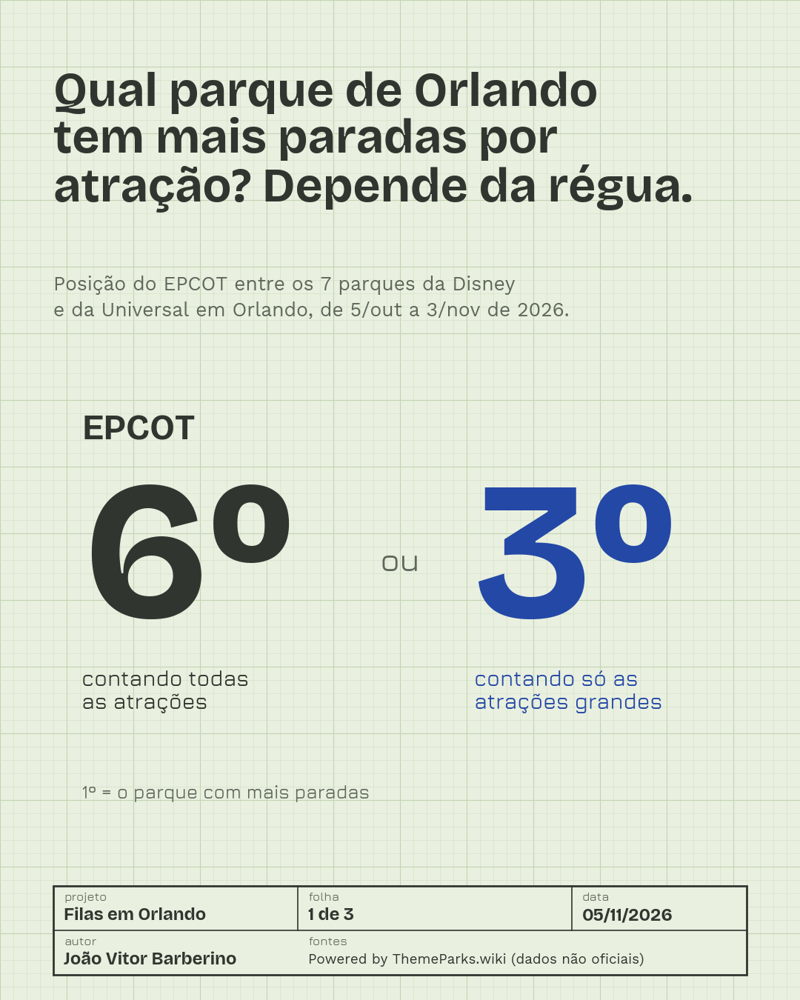

# Filas em Orlando | Análise de dados aplicada à gestão de operações

Projeto independente de análise de dados em **Python** que acompanha o funcionamento das atrações de sete parques temáticos de Orlando, sob a perspectiva da **Engenharia de Produção**.

O objetivo é investigar como demanda, interrupções operacionais, políticas de preços e previsões se relacionam com a experiência de espera — e quais aprendizados podem ser transferidos para outras operações com filas.

## Parques analisados

- Magic Kingdom
- EPCOT
- Disney's Hollywood Studios
- Disney's Animal Kingdom
- Universal Studios Florida
- Universal Islands of Adventure
- Universal Epic Universe

## Primeira análise: a composição das atrações altera o ranking

**Período:** 5 de outubro a 3 de novembro de 2026 (30 dias).

A pergunta inicial foi: *qual parque registra mais paradas por atração?*

O EPCOT aparece em **6º lugar** quando consideradas todas as atrações analisadas, mas em **3º lugar** ao comparar apenas atrações classificadas como grandes (fila anunciada média de pelo menos 20 minutos). A mudança demonstra como a composição das unidades analisadas pode influenciar indicadores agregados.



### Critérios da análise

- Contagem de interrupções de **10 minutos ou mais**.
- Normalização por **10 horas de operação da atração**, apenas durante o horário regular do parque.
- Exclusão de teatros e cinemas para reduzir diferenças de categorização entre as fontes.
- Exclusão, da contagem principal, de paradas em atrações ao ar livre associadas a trovoadas identificadas nos boletins meteorológicos de aeroportos próximos.
- Classificação de atrações grandes por **fila anunciada média de pelo menos 20 minutos**, indicador de demanda relativa, não de porte físico.
- Testes de robustez com diferentes cortes e reamostragens.

**Limitações:** são apenas 30 dias; a classificação de porte utiliza a fila *anunciada*, não a espera real nem a capacidade da atração. O EPCOT reúne apenas cinco atrações na categoria “grande” nessa amostra. Uma parada registrada não implica acidente, falha de segurança ou motivo operacional conhecido; o status pode refletir procedimentos de proteção. A associação de trovoadas a paradas é aproximada, pois as estações meteorológicas não estão dentro dos parques.

## Organização do código

| Arquivo | Finalidade |
|---|---|
| `baixar_historico.py` | Coleta de histórico e horários via ThemeParks.wiki |
| `limpar_paradas.py` | Tratamento dos eventos e criação dos indicadores |
| `checar_clima.py` | Cruzamento com boletins METAR de trovoadas |
| `robustez.py` | Testes de sensibilidade e reamostragem dos rankings |
| `carrossel_estreia.py` | Geração dos gráficos e do PDF para a publicação |
| `atracoes_ar_livre.csv` | Classificação de atrações suscetíveis a paradas por raio |
| `fontes_quinta/` | Fontes utilizadas nos gráficos, acompanhadas das licenças OFL |

As imagens `carrossel_*.png` e o documento `carrossel_estreia.pdf` apresentam o primeiro estudo.

## Como executar localmente

Requisitos: Python 3.10+ e acesso à internet para as etapas de coleta.

1. Crie um ambiente virtual (opcional, recomendado) e instale as dependências:

   ```bash
   python -m pip install -r requirements.txt
   ```

2. Crie o arquivo `.env` na raiz local a partir do modelo `.env.example`, preenchendo **sua própria chave** de API da ThemeParks.wiki. Nunca compartilhe esse arquivo.

3. Na ordem, execute:

   ```bash
   python baixar_historico.py
   python limpar_paradas.py
   python checar_clima.py
   python robustez.py
   python carrossel_estreia.py
   ```

A pasta `dados/` é gerada localmente e **não faz parte do repositório público**. Os gráficos são gerados a partir dos dados obtidos e tratados no ambiente do usuário. Como o histórico da API gratuita tem janela móvel, o intervalo original do primeiro estudo pode não estar disponível para novas contas.

## Fontes, créditos e condições de uso

- **Powered by [ThemeParks.wiki](https://themeparks.wiki)** — histórico do status das atrações, filas anunciadas e horários de funcionamento. Dados não oficiais.
- **NOAA / NWS**, consultados por meio do [Iowa Environmental Mesonet (Iowa State University)](https://mesonet.agron.iastate.edu/) — boletins meteorológicos METAR.

Os resultados divulgados são **análises agregadas**. Os dados brutos e tratados obtidos da ThemeParks.wiki não são republicados aqui em respeito às [condições de uso da fonte](https://www.themeparks.wiki/terms). O projeto é independente e **não possui vínculo, patrocínio ou endosso da Disney, da Universal ou da ThemeParks.wiki**.

## Autor

João Vitor Barberino — Engenharia de Produção, UFSCar.

[LinkedIn](https://www.linkedin.com/in/joaovitorbarberino/) · [GitHub](https://github.com/JoaoBarberino)

> Projeto em desenvolvimento. Novas análises serão adicionadas progressivamente.
